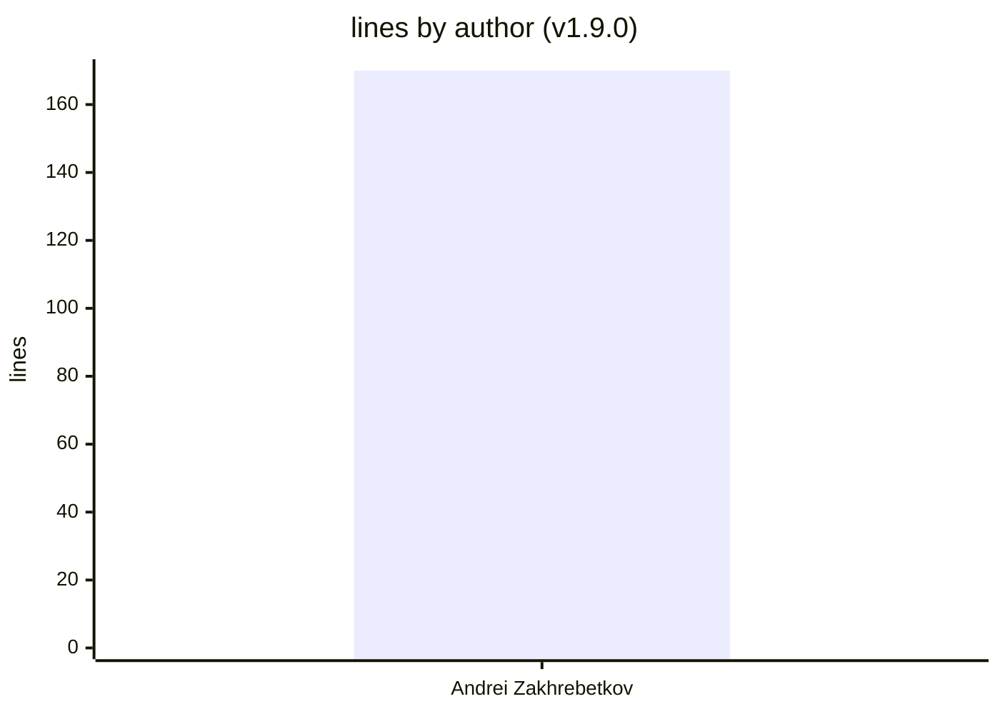

# Report v1.10.0

## Velocity (release — points merged since v1.9.0)
- tooling: 1 pt

## Cycle time (client clocks — commit dates are self-reported)
- median 0.1h, p85 0.1h over 1 task(s)

## Fix share (fix/-prefix merges / all merges in the range)
- 0 fix / 2 merges (0%)

## Return rate (same-ID re-merges — a retake is rework; the cause is retro business)
- 0 return(s) across 1 merged task(s) (0%)

## Backlog growth (tasks born after the plan's birth, 2026-11-24T18:31:38)
- none — nothing born after the plan
- unplanned work that actually merged is the retro's actual-only (`jear retro`) — not duplicated here

## Attribution (derived: most commits per task branch)
- tooling/69 — Andrei Zakhrebetkov

## Points-in-time (lead time by size — wall clock, client commit dates)
- 1 pt: median 0.1h, p85 0.1h (n=1)

## Review latency (server clocks — the forge PR created/merged)
- median 0.1h, p85 0.1h over 1 PR(s)

## Authorship (lines by author — volume, not value)

- Andrei Zakhrebetkov: +170 / -167

