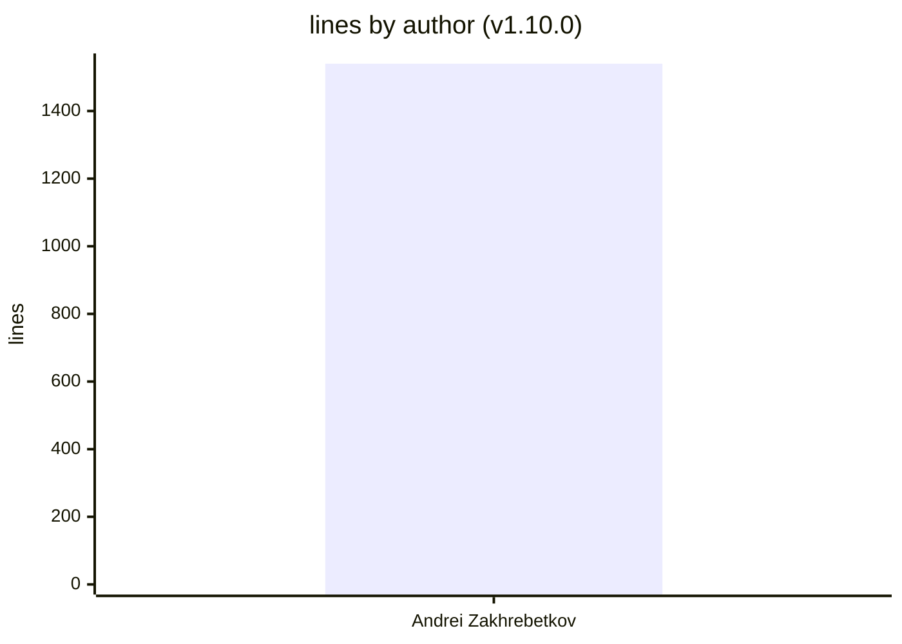

# Report v1.13.3

## Velocity (release — points merged since v1.10.0)
- tooling: 16 pt

## Cycle time (client clocks — commit dates are self-reported)
- median 0.2h, p85 0.6h over 8 task(s)

## Fix share (fix/-prefix merges / all merges in the range)
- 3 fix / 16 merges (19%)

## Return rate (same-ID re-merges — a retake is rework; the cause is retro business)
- 1 return(s) across 8 merged task(s) (12%)
  - tooling/74  trailers in the state join — the board sees trailer-declared deliveries  [953149b]

## Backlog growth (tasks born after the plan's birth, 2026-11-28T09:22:14)
- none — nothing born after the plan
- unplanned work that actually merged is the retro's actual-only (`jear retro`) — not duplicated here

## Attribution (derived: most commits per task branch)
- tooling/64 — Andrei Zakhrebetkov
- tooling/67 — Andrei Zakhrebetkov
- tooling/70 — Andrei Zakhrebetkov
- tooling/71 — Andrei Zakhrebetkov
- tooling/72 — Andrei Zakhrebetkov
- tooling/73 — Andrei Zakhrebetkov
- tooling/74 — Andrei Zakhrebetkov
- tooling/75 — Andrei Zakhrebetkov

## Points-in-time (lead time by size — wall clock, client commit dates)
- 1 pt: median 0.2h, p85 0.2h (n=4)
- 2 pt: median 1.1h, p85 1.6h (n=2)
- 3 pt: median 0.2h, p85 0.2h (n=1)
- 5 pt: median 0.5h, p85 0.5h (n=1)

## Review latency (server clocks — the forge PR created/merged)
- median 0.2h, p85 0.6h over 8 PR(s)

## Authorship (lines by author — volume, not value)

- Andrei Zakhrebetkov: +1540 / -279

