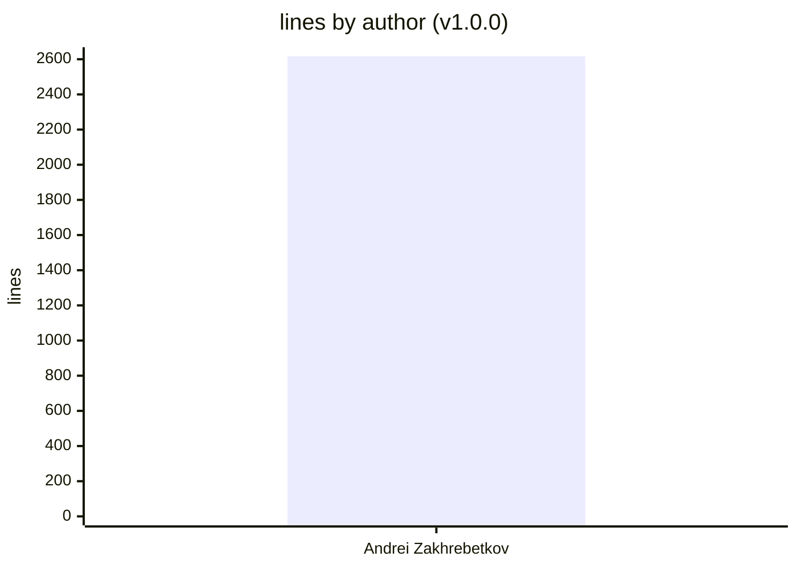

# Report v1.9.0

## Velocity (release — points merged since v1.0.0)
- tooling: 21 pt

## Cycle time (client clocks — commit dates are self-reported)
- median 0.2h, p85 1.8h over 11 task(s)

## Fix share (fix/-prefix merges / all merges in the range)
- 1 fix / 18 merges (6%)

## Return rate (same-ID re-merges — a retake is rework; the cause is retro business)
- 0 return(s) across 11 merged task(s) (0%)

## Backlog growth (tasks born after the plan's birth, 2026-11-24T18:31:38)
- none — nothing born after the plan
- unplanned work that actually merged is the retro's actual-only (`jear retro`) — not duplicated here

## Attribution (derived: most commits per task branch)
- tooling/55 — Andrei Zakhrebetkov
- tooling/56 — Andrei Zakhrebetkov
- tooling/57 — Andrei Zakhrebetkov
- tooling/58 — Andrei Zakhrebetkov
- tooling/59 — Andrei Zakhrebetkov
- tooling/60 — Andrei Zakhrebetkov
- tooling/61 — Andrei Zakhrebetkov
- tooling/62 — Andrei Zakhrebetkov
- tooling/63 — Andrei Zakhrebetkov
- tooling/66 — Andrei Zakhrebetkov
- tooling/68 — Andrei Zakhrebetkov

## Points-in-time (lead time by size — wall clock, client commit dates)
- 1 pt: median 0.2h, p85 4.6h (n=3)
- 2 pt: median 0.3h, p85 1.0h (n=6)
- 3 pt: median 1.9h, p85 3.5h (n=2)

## Review latency (server clocks — the forge PR created/merged)
- median 0.2h, p85 0.3h over 11 PR(s)

## Authorship (lines by author — volume, not value)

- Andrei Zakhrebetkov: +2617 / -618

