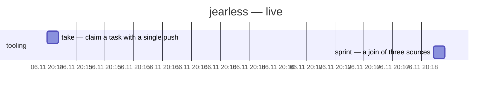

# jearless

<p align="center">
  
</p>

**Fearless. Jearless.** Task tracking and a changelog on bare git — for small teams.

It runs on **PURE git** — no server, no database, no daemons — which makes it fit for CI runners, on-prem boxes and fully autonomous or embedded systems where no human operator exists.

*Why the name: by ear — a faint echo of Jira; by sight — fearless; spelled with an error — and we track errors for a living; a jearless sprint — a fast run without fat. The mascot: a hedgehog whose spines are a gear.*

A git-native task tracker: the registry is a versioned YAML, the state is derived from branches and merge commits, the changelog, reports and charts are generated at release time. No tracker service, no database, no daemons — one dependency (ruamel.yaml), one Python package (pipx), your own repository as the single source of truth.

## Install

```sh
pipx install jearless        # the intended way for daily use
```

POSIX systems only (Linux, macOS — WSL counts as Linux); native Windows is untested.

For development: `uv venv && uv pip install -e ".[dev]"` (or the pip equivalent), then `pre-commit install`.

## Quickstart

Inside your git repository:

```sh
jear add door "paint it black" --points 2   # a task in the eternal registry — carried to a pull request
jear take door 1                            # branch feature/door/1-paint-it-black, pushed — the push IS the claim
# ... work on the branch, then open a pull request ...
jear sprint                                 # available / in_progress / done / rejected — derived from git
jear doctor                                 # the audit: unattributed commits, naming, registry health
```

Main accepts changes only through pull requests: the merge button belongs to the reviewer. The
`--no-ff` merge commit is the only carrier of "this task shipped" — squash and rebase merges
are disabled.

No statuses are ever stored. Three sources — the registry, the branches, the merge history — are joined on demand.

## What it draws (real output)

The actual timeline of a sprint — start = the branch's first commit, end = the merge:



The sprint board (mermaid kanban), the burn-down and the velocity trend (`xychart-beta`), the changelog and a PM report per release — all derived, all portable text.

## How it works

| State | Derived from |
|---|---|
| available | in `tasks.yml`, no branch on origin, no merge commit |
| in_progress | a branch exists on origin |
| done | a merge commit naming the task, in main |
| rejected | the task carries a `rejected:` cause — it wins over every other state |

An archived task (moved out at a release) leaves the working set: it shows on the board only while a live branch carries it — a retake by its old ID works (`jear take --type fix`, task tooling/40).

- **The eternal registry** (`.jearless/tasks.yml`): frozen facts only — id, summary, description, story_points, `depends_on`. Tasks are never deleted. No status fields: git knows the state. The contract is enforced on read: a boolean `id`, `story_points` below 1 and a project name outside `[a-z0-9_]` are refused loudly — a hand-edited registry fails at load, not later in a branch name (tooling/70).
- **Taking a task = pushing a branch**: `jear take door 1` checks occupancy via the remote first (advisory — `ls-remote`), and the push arbitrates the race for identical branch names — though git may answer `Everything up-to-date` when the branch already carries that exact commit. Exclusive ownership is not required: two engineers on one task are both visible on the board.
- **Two engineers, one task — the Vasya and Masha model**: the first merge is the `done` signal. If the contract check finds gaps, Vasya re-takes the task (`jear take --type fix`) and the board shows the rework; the full story lives in `jear log`. Whether front-end and database work deserve separate tasks is the team's own call — the same ID means the same task.
- **The changelog, reports and charts are generated at release time** from merge commits between tags. Nothing is stored — everything is a join. The report carries velocity, cycle time (client-clock disclaimer), fix share, return rate (same-ID re-merges), backlog growth and attribution — the name is the task branch's most frequent committer, enough to find the first person to talk to.
- **Every pull request gets a dashboard** — the sprint gantt, the burn-down and the board as one sticky comment. Dashboards ride the forge, never the tree.
- **The whole join exports** — `jear export --format csv|json`: one row per task with its state, branch and every date (created, taken, merged, plus the forge's server clocks). CSV opens in any spreadsheet, JSON feeds integrations. Period boundaries (`--from/--to`: a date, a delivered task, a release tag or a branch name) never drop rows — they fill the `in_period` column.
- **Hours are not measured; duration is.** Lead time per story point (Points-in-time), review latency and the commit rhythm are reported as wall-clock duration. They calibrate estimates and inform assignments; they are never evidence of how hard anyone worked.
- **`jear doctor`** audits main: unattributed commits (squash/fast-forward scars) are loud; acknowledged scars live in the `.jearless/doctor_ignore` ledger, counted aloud.
- **Trunk-based by default, with an optional intermediate branch.** If your team integrates unreleased work on `dev`, `release-1` or a per-sprint branch before it reaches main, name it once: `[git] integration_ref = "dev"` in `.jearless.toml`. A task is done once it reaches that branch, and new task branches fork from its tip. One such branch at a time. One such branch is in view at a time. A worked example — a branch per sprint, from `jear take` to the delivery — and the limits of the mode are in [manifest.md](manifest.md), under *GitFlow mode*.

Ad-hoc questions (total effort, per-project sums, dependencies) answer by one-liners — the query cookbook: [COOKBOOK.md](COOKBOOK.md).

Smaller tools for the same loop: `jear reject <project> <id> <cause>` withdraws a task with a mandatory reason, `jear log <project> <id>` shows one task's full history across branches and merges, `jear prune` removes local copies of merged branches, `jear rhythm` maps when landed work happens, `jear message <project>/<id>` prints the squash-box message carrying the `Task:` trailer.

The philosophy behind it — EngineerOps, the engineer-first artifact model — lives in [ENGINEEROPS.md](ENGINEEROPS.md) (Concept 0.1).

The planning rules — why there is no priority field, why kind is declared while membership is derived, why hours are honestly unanswered — live in [manifest.md](manifest.md). The mechanics of contributing: [CONTRIBUTING.md](CONTRIBUTING.md). The implementation plan and its reasoning: [PLAN.md](PLAN.md).

## Release checklist

Human-run, in two phases: `jear release` prepares a `release/<tag>` branch and its pull request; after the merge, `jear release --finalize <tag>` lands the tag and prints the authored checklist (`.jearless/release.md`): build, publish (TestPyPI rehearsal on metadata change), verify via the JSON API.

## The fine print

- **Scale**: hundreds of merges a day ≈ tens of seconds per report (git subprocess fan-out) — built for small teams, honestly.
- **The legacy root registry still works** (with a nudge) — `.jearless/` is the canonical home.
- **A released-but-unpublished version drifts** — which is why every release ends with its checklist.

## The idea, compressed

Automation of tasks and a changelog on bare git. The design debates — why the registry is eternal, why the state is derived, why the first arrival wins — and the decisions they produced are the project's core; they live in the README's history and [manifest.md](manifest.md).

**Status**: the design has stabilized through dogfooding — the tool has tracked, released and audited its own development since its first day.
